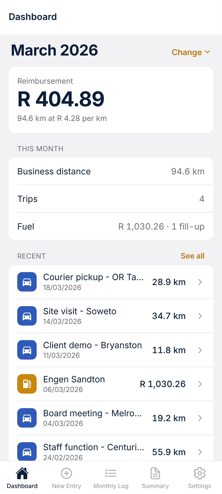
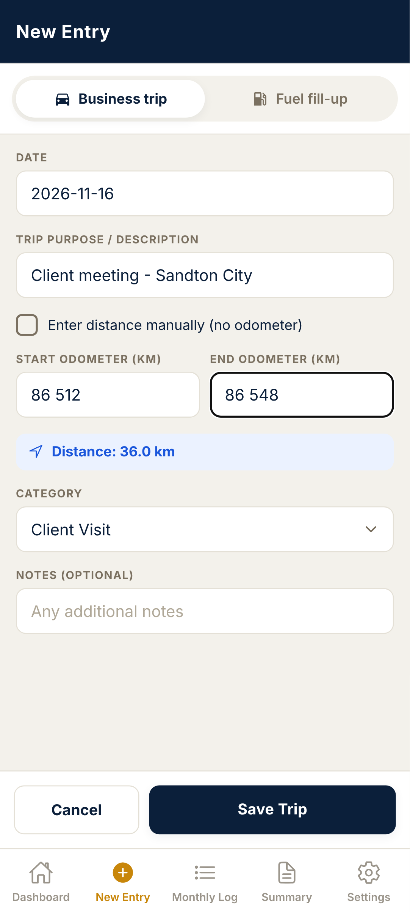
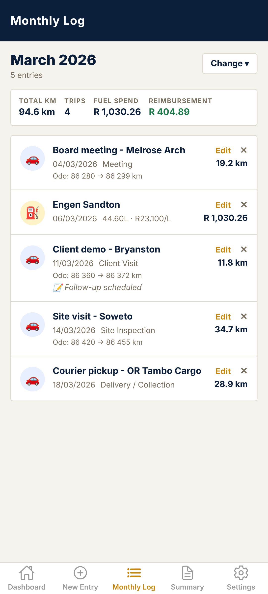
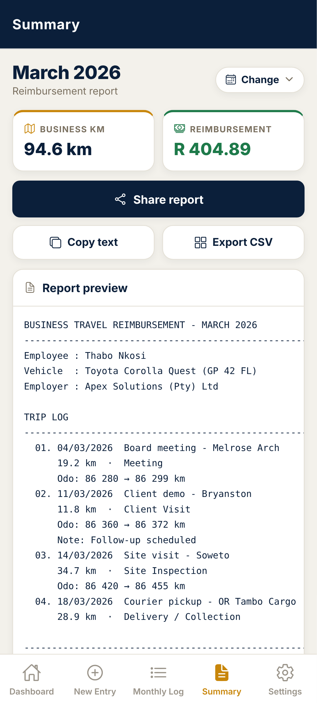
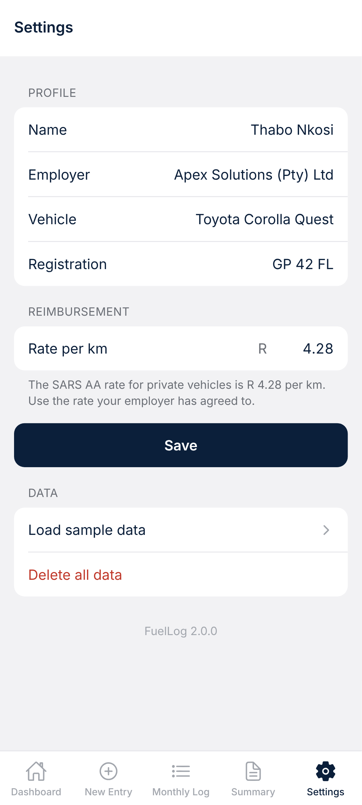

# FuelLog - Business Travel & Fuel Tracker

[](https://github.com/MrPettitt/fuellog-app/actions/workflows/ci.yml)
[](https://github.com/MrPettitt/fuellog-app/actions/workflows/release.yml)
[](https://github.com/MrPettitt/fuellog-app/releases/latest)

A cross-platform iOS & Android app built with React Native (Expo) for employees to track business travel and fuel usage, then share a formatted reimbursement report with their employer.

---

## Features

- 🚗 **Trip Logging** - Odometer readings (start/end) or manual km entry
- ⛽ **Fuel Fill-ups** - Litres, price per litre, auto-calculated total
- ✏️ **Edit entries** - Fix any trip or fill-up from the Monthly Log without deleting it
- 📊 **Dashboard** - Monthly overview with km, trips, fuel spend & reimbursement
- 📋 **Monthly Log** - Full entry history by month
- 📤 **Summary Report** - Formatted reimbursement report to share/copy to employer
- 📈 **CSV export** - Share the month as a spreadsheet-ready `.csv` file
- 💾 **Persistent storage** - All data saved locally on the device; data the app cannot read is backed up, never overwritten
- 🧪 **Demo data on request** - The app starts empty; load three months of sample data from Settings to try it out
- 🇿🇦 **South African defaults** - SARS AA rate (R 4.28/km), ZAR formatting, SA date format

---

## Screenshots

Captured at phone size (412 × 915) with the demo data loaded from **Settings → Load demo data**.

| Dashboard | New Entry | Monthly Log |
| :---: | :---: | :---: |
|  |  |  |

| Summary | Settings |
| :---: | :---: |
|  |  |

---

## Getting Started

### Prerequisites

- [Node.js](https://nodejs.org/) v18 or higher (CI uses Node 22)
- The [Expo Go](https://expo.dev/go) app on your phone, or an Android emulator / iOS simulator

No global install is needed: `npx expo` runs the bundled Expo CLI.

### Install & Run

```bash
# 1. Install dependencies
npm install

# 2. Start the development server
npx expo start

# 3. Run the unit tests
npm test
```

Then scan the QR code with:
- **iOS**: The built-in camera app
- **Android**: The [Expo Go](https://expo.dev/go) app

---

## Releases

Every version is published on the [Releases page](https://github.com/MrPettitt/fuellog-app/releases), with the notes from [`CHANGELOG.md`](CHANGELOG.md) and an installable Android APK attached.

The release is created automatically by the **Release** workflow when a commit on `main` changes the version. To ship a new version:

1. Bump `version` in `package.json` and `app.json`, and increment `expo.android.versionCode` and `expo.ios.buildNumber` in `app.json`.
2. Add a `## x.y.z - YYYY-MM-DD` section to the top of `CHANGELOG.md`.
3. Merge to `main`. The workflow runs the tests, tags `vx.y.z`, creates the GitHub Release, then builds the APK and attaches it.

The APK is signed with the standard debug keystore, which is fine for side-loading and testing. Store builds should go through EAS Build (below) with your own signing keys.

---

## Building for Production

Builds use [EAS Build](https://docs.expo.dev/build/introduction/). The app identifiers in `app.json` (`com.mrpettitt.fuellog`) are the ones to change if you publish under your own name.

### Android (APK/AAB)
```bash
npx eas build --platform android
```

### iOS (IPA)
```bash
npx eas build --platform ios
```

> Note: iOS builds require an Apple Developer account ($99/year).

---

## Project Structure

```
fuellog-app/
|-- App.js                       # Root - navigation + global context
|-- app.json                     # Expo config (version, identifiers, icons)
|-- package.json
|-- CHANGELOG.md                 # Release notes (the Release workflow reads these)
|-- assets/                      # App icon, adaptive icon, splash, favicon
|-- docs/screenshots/            # README screenshots
|-- __tests__/                   # Jest unit tests (utils, storage)
|-- jest.global-setup.js         # Pins the test time zone to Africa/Johannesburg
|-- .github/workflows/
|   |-- ci.yml                   # CI: tests + Android/iOS bundle
|   `-- release.yml              # Tag + GitHub Release + APK on version bump
`-- src/
    |-- AppContext.js            # Shared app state context
    |-- components/              # MonthPicker (header chip + sheet), EntryBadge
    |-- storage.js               # Safe load/save of the saved data
    |-- theme.js                 # Design tokens (colours, etc.)
    |-- utils.js                 # Helpers, formatters, CSV export, demo data
    `-- screens/
        |-- DashboardScreen.js   # Home stats & recent entries
        |-- AddEntryScreen.js    # Trip / fuel entry form (also used to edit)
        |-- MonthlyLogScreen.js  # Full monthly entry list
        |-- SummaryScreen.js     # Shareable reimbursement report + CSV
        `-- SettingsScreen.js    # Profile, reimbursement rate, demo data
```

---

## Reimbursement Rate

The default rate is **R 4.28/km** (SARS AA rate for private vehicles under 1600cc). Adjust this in **Settings** to match whatever rate your employer has agreed to pay.

---

## License

Released under the [MIT License](LICENSE). Feel free to customise it for your company.
