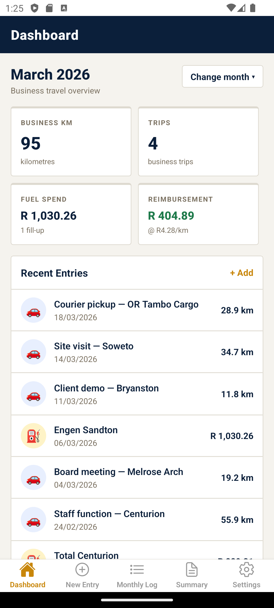
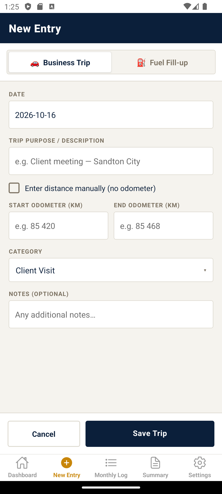
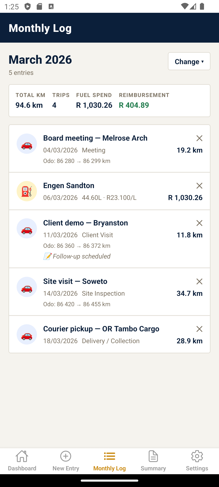
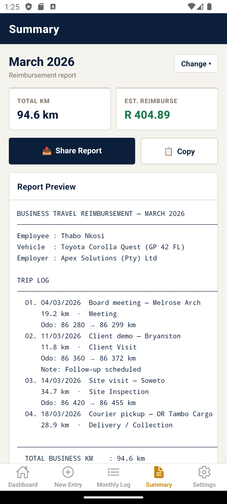

# FuelLog - Business Travel & Fuel Tracker

A cross-platform iOS & Android app built with React Native (Expo) for employees to track business travel and fuel usage, then share a formatted reimbursement report with their employer.

---

## Features

- 🚗 **Trip Logging** - Odometer readings (start/end) or manual km entry
- ⛽ **Fuel Fill-ups** - Litres, price per litre, auto-calculated total
- 📊 **Dashboard** - Monthly overview with km, trips, fuel spend & reimbursement
- 📋 **Monthly Log** - Full entry history by month
- 📤 **Summary Report** - Formatted reimbursement report to share/copy to employer
- 💾 **Persistent storage** - All data saved locally on the device
- 🇿🇦 **South African defaults** - SARS AA rate (R 4.28/km), ZAR formatting, SA date format

---

## Screenshots

Captured on an Android 14 emulator running the demo data.

| Dashboard | New Entry | Monthly Log |
| :---: | :---: | :---: |
|  |  |  |

| Summary |
| :---: |
|  |

---

## Getting Started

### Prerequisites

- [Node.js](https://nodejs.org/) v18 or higher
- [Expo CLI](https://docs.expo.dev/get-started/installation/)

```bash
npm install -g @expo/cli
```

### Install & Run

```bash
# 1. Install dependencies
npm install

# 2. Start the development server
npx expo start

# 3. Run the unit tests
npm test
```

Then scan the QR code with:
- **iOS**: The built-in camera app
- **Android**: The [Expo Go](https://expo.dev/client) app

---

## Building for Production

### Android (APK/AAB)
```bash
npx expo build:android
# or with EAS Build:
npx eas build --platform android
```

### iOS (IPA)
```bash
npx expo build:ios
# or with EAS Build:
npx eas build --platform ios
```

> Note: iOS builds require an Apple Developer account ($99/year).

---

## Project Structure

```
fuellog-app/
├── App.js                       # Root - navigation + global context
├── app.json                     # Expo config
├── package.json
├── __tests__/                   # Jest unit tests for utils
├── .github/workflows/ci.yml     # CI: tests + Android/iOS bundle
└── src/
    ├── AppContext.js            # Shared app state context
    ├── theme.js                 # Design tokens (colours, etc.)
    ├── utils.js                 # Helpers, formatters, dummy data
    └── screens/
        ├── DashboardScreen.js   # Home stats & recent entries
        ├── AddEntryScreen.js    # Trip / fuel entry form
        ├── MonthlyLogScreen.js  # Full monthly entry list
        ├── SummaryScreen.js     # Shareable reimbursement report
        └── SettingsScreen.js    # Profile and reimbursement rate
```

---

## Reimbursement Rate

The default rate is **R 4.28/km** (SARS AA rate for private vehicles under 1600cc). Adjust this in **Settings** to match whatever rate your employer has agreed to pay.

---

## License

MIT - feel free to customise for your company.
